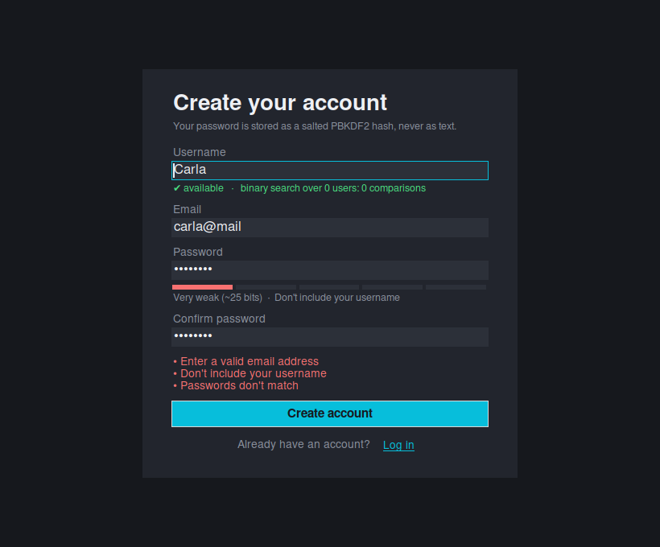
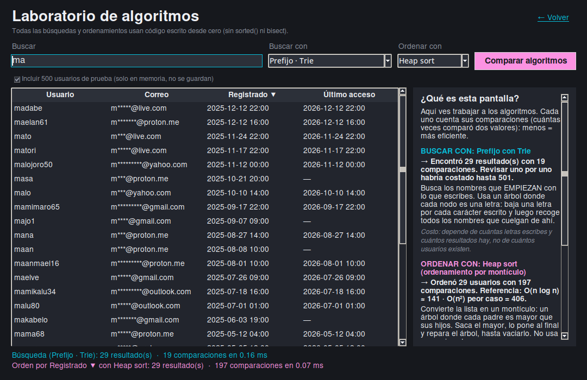
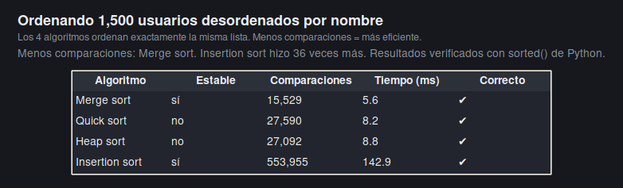

# Login-Python

A sign-up / log-in app I wrote to learn algorithms in a practical way, written twice, years apart. Both versions are kept so the difference is visible.

| | [v1](v1/) (2021) | [v2](v2/) — AuthLab |
|---|---|---|
| Sorting | Merge sort on the first letter of the name | **4 algorithms written from scratch** (hybrid merge sort, 3-way quicksort, heapsort, insertion sort) with comparison counting |
| Searching | Recursive binary search on the first letter | **Binary search, prefix range search and a Trie**, all hand-written |
| Passwords | Plain text, lowercased | Salted **PBKDF2-SHA256** hash (600,000 iterations), case-sensitive, strength meter |
| Login security | — | Same error for unknown user and wrong password, constant-time checks, lockout after 5 failed attempts |
| Storage | Space-separated `Users.txt` | JSON with atomic writes, kept sorted at all times |
| Tests | None | 57 pytest tests on Windows, macOS and Linux (GitHub Actions) |
| Extras | — | **Algorithms Lab** (in Spanish): search and sort users live, see comparisons and time, benchmark every algorithm, with a help panel that explains each one |

 

📐 **[Architecture, algorithms and technical details](v2/docs/ARCHITECTURE.md)** has diagrams, step-by-step traces of every algorithm, measured results, the security design, the testing strategy, and known limitations.

## Algorithms (all in [`v2/authlab/algorithms/`](v2/authlab/algorithms/))

None of these use `sorted()`, `list.sort()`, `bisect` or any library. Python's `sorted()` appears only in the tests and the benchmark, as an independent referee that checks the results.

### Sorting — [`sorting.py`](v2/authlab/algorithms/sorting.py)

| Algorithm | Average | Worst | Extra memory | Stable | Notes |
|---|---|---|---|---|---|
| **Merge sort** (default) | O(n log n) | O(n log n) | O(n) | ✔ | Hybrid: insertion sort below 16 items, and it skips merges when the halves are already in order, so sorted input is O(n) |
| **Quick sort** | O(n log n) | O(n²)* | O(log n) | ✘ | Random pivot + 3-way partition (Dijkstra), so duplicates are fast; recurses into the smaller side only |
| **Heap sort** | O(n log n) | O(n log n) | O(1) | ✘ | Bottom-up heapify in O(n), then repeatedly moves the max to the end |
| **Insertion sort** | O(n²) | O(n²) | O(1) | ✔ | Best for tiny or almost-sorted lists; used inside merge sort, quick sort and the trie |

\* Practically impossible with a random pivot.

All four share the interface `algorithm(items, key=None, reverse=False, metrics=None)`. `Metrics` counts every key comparison, which is how the Lab and the benchmark measure them. Measured on 1,500 shuffled users:



### Searching

| Algorithm | Where it's used | Cost |
|---|---|---|
| **Binary search** (`lower_bound`) — [`searching.py`](v2/authlab/algorithms/searching.py) | Log in, "username available?", inserting a new user at its sorted position | O(log n): about 20 comparisons for 1,000,000 users |
| **Prefix range** — two binary searches | Lab: all usernames starting with "ma" | O(log n) + results |
| **Trie** (prefix tree) — [`trie.py`](v2/authlab/algorithms/trie.py) | Lab: the same prefix search with a different data structure | O(prefix length + results), however many users exist |

### How they fit together

Users are stored in a list that is **always sorted by username**. Merge sort sorts it once when the file is loaded, in case it was edited by hand. After that, `lower_bound` finds the exact spot to insert each new user. Because the list stays sorted, every lookup can use binary search instead of checking every user.

```
authlab/
  algorithms/   sorting, searching, trie, metrics  ← written from scratch
  security.py   PBKDF2 hashing + password strength (entropy estimate)
  storage.py    UserStore: sorted list + trie in memory, JSON on disk
  auth.py       sign-up rules, login, lockout (no UI code → fully tested)
  directory.py  data behind the Algorithms Lab + benchmark + demo users
  gui.py        Tkinter screens: Sign up → Log in → Home → Lab
docs/           screenshots and ARCHITECTURE.md
```

## Security: what's done and why

The cryptography is **deliberately not written from scratch**. Writing your own crypto is one of the classic security mistakes, so v2 uses PBKDF2 from Python's standard library, which is well reviewed.

- **Hashing.** Passwords are stored as `pbkdf2_sha256$600000$<salt>$<hash>`, never as text. A random salt per user means two people with the same password get different hashes. 600,000 iterations make each guess slow (~0.2 s), which barely affects a login but makes cracking a stolen file impractical.
- **No user enumeration.** "Unknown user" and "wrong password" show the same message. An unknown user still goes through a full hash, so both take the same time. Lockouts also apply to usernames that don't exist.
- **Brute-force protection.** After 5 wrong passwords in a row, the account is locked for 30 seconds.
- **Constant-time comparison.** `hmac.compare_digest` takes the same time no matter where two hashes differ.
- **Strength meter.** It estimates entropy (length × log₂ of the character pool) and lowers the estimate for common passwords, passwords that contain the username, and repeated characters. A password must be at least "Fair" to register.
- **Data stays out of the repo.** v2 keeps users in your OS's app-data folder (`%APPDATA%`, `~/Library/Application Support` or `~/.local/share`), never in the project folder.

## Install and run

You need **Python 3.10 or newer**. The app only uses the standard library.

| System | Get Python with Tkinter |
|---|---|
| Windows | Install from [python.org](https://www.python.org/downloads/). Keep **"tcl/tk and IDLE"** ticked and tick **"Add python.exe to PATH"**. |
| macOS | Install from [python.org](https://www.python.org/downloads/), which includes Tk, or with Homebrew: `brew install python python-tk`. |
| Linux | `sudo apt install python3-tk python3-venv` (Debian/Ubuntu) or your distro's equivalent. |

Windows (PowerShell):

```powershell
cd v2
py -m venv .venv
.venv\Scripts\activate
pip install -r requirements.txt
authlab
```

macOS / Linux:

```bash
cd v2
python3 -m venv .venv
source .venv/bin/activate
pip install -r requirements.txt
authlab
```

If you'd rather not install anything, run `python -m authlab` from inside `v2/`.

### Tests

```bash
pip install -r requirements-dev.txt
pytest
```

## About v1

`v1/` is the original 2021 version, kept so the progress is visible, with the bugs that stopped it from working fixed:

- Registration crashed on every attempt (`datetime.now()` on the module instead of the class).
- Merge sort lost or duplicated users (it incremented `j` instead of `k`).
- Empty lines in `Users.txt` crashed the sort.
- Binary search swapped `high` and `low` in its recursive calls, so only the middle user could log in.
- Login compared only the first letter of the name: `c` plus Carla's password logged in as Carla.
- No message was shown for an unknown user or a wrong password.

v1 still stores passwords as plain text. That's why v2 exists. The `Users.txt` included in `v1/` only has made-up sample accounts.

Run it from inside `v1/` with `python main.py`, and log in with `demo` / `demo1234`, or create your own account.
