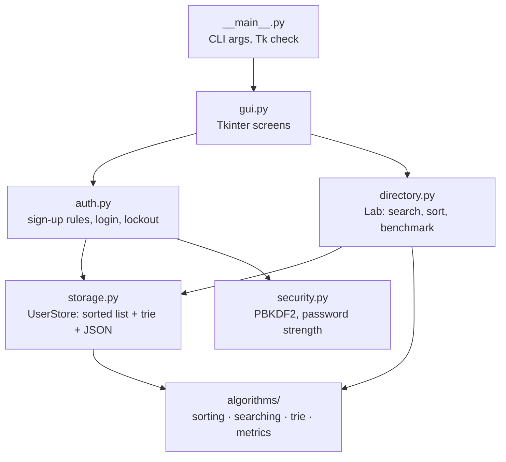
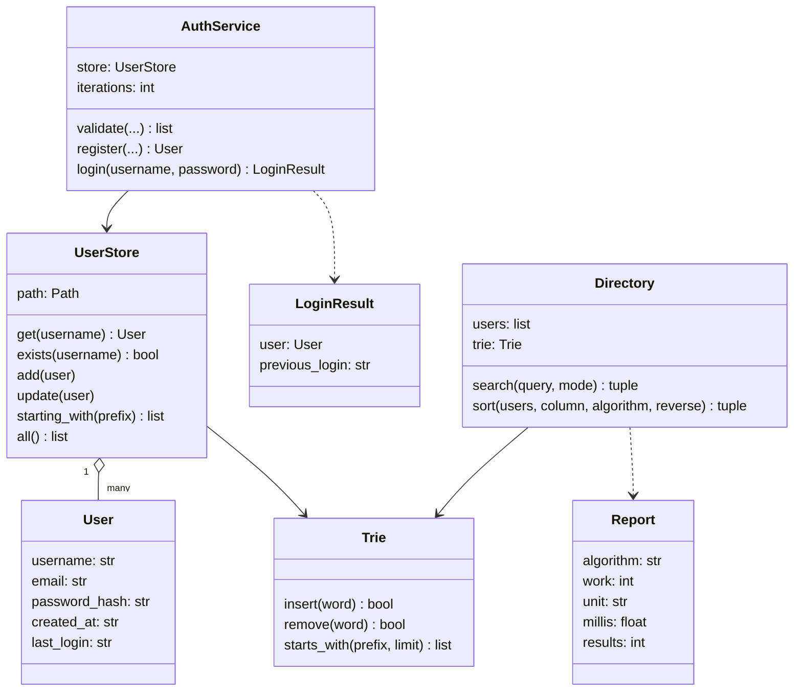
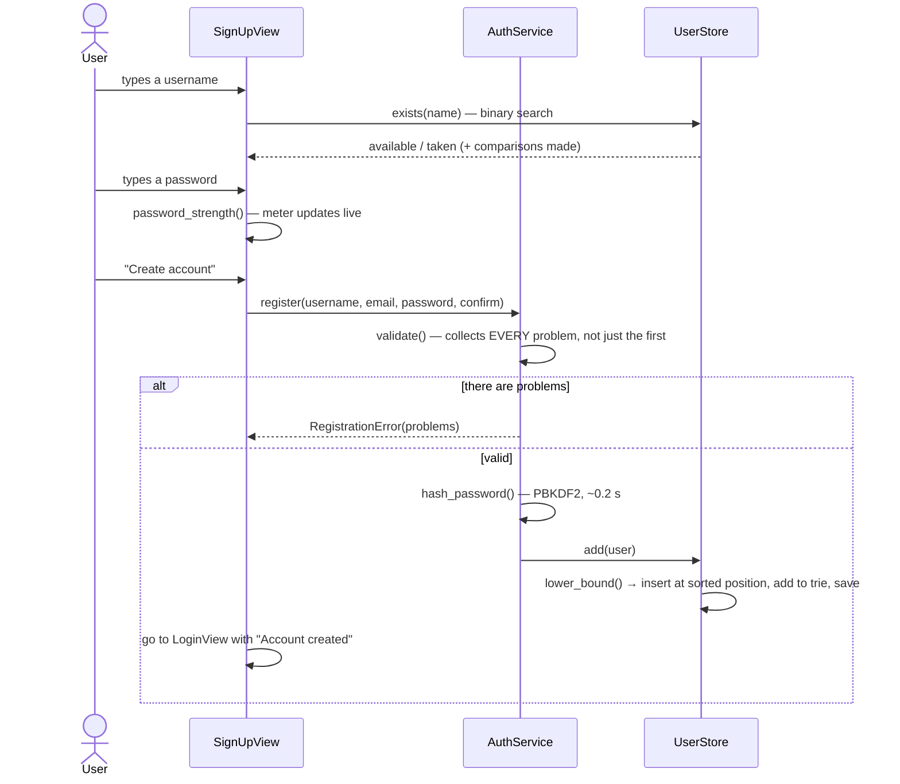
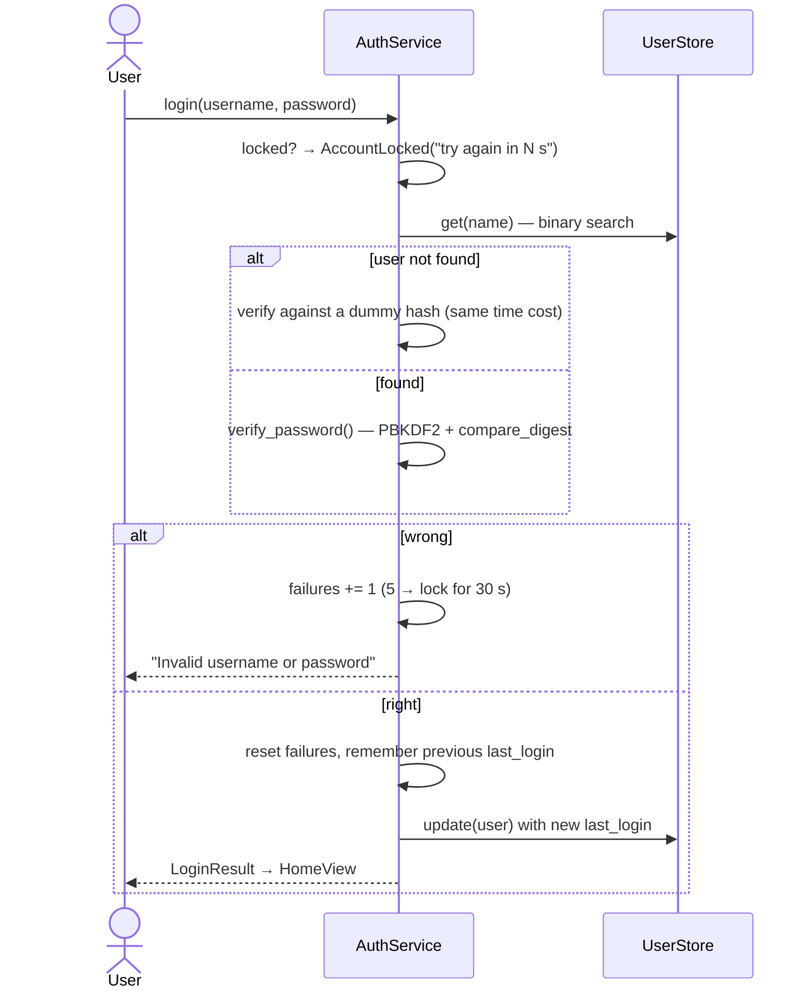
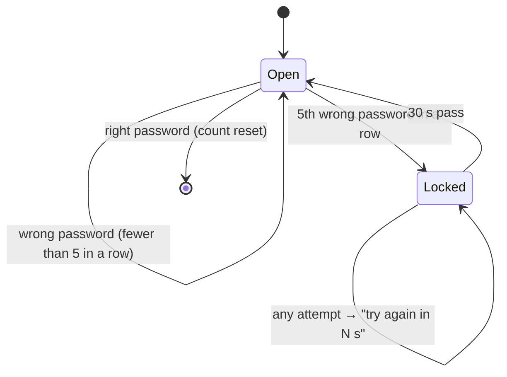

# AuthLab — Architecture, algorithms and technical details

This document explains how v2 is built, how each algorithm works, and the technical decisions behind it. For installing and running the app, see the [main README](../../README.md).

Every number in this document was measured by running the project's code, not estimated.

- [1. Goals](#1-goals)
- [2. Architecture](#2-architecture)
- [3. Main flows](#3-main-flows)
- [4. Data model and storage](#4-data-model-and-storage)
- [5. Sorting algorithms](#5-sorting-algorithms)
- [6. Searching algorithms](#6-searching-algorithms)
- [7. Security](#7-security)
- [8. User interface](#8-user-interface)
- [9. Testing strategy](#9-testing-strategy)
- [10. Design decisions](#10-design-decisions)
- [11. Known limitations and future work](#11-known-limitations-and-future-work)

---

## 1. Goals

1. **Learn algorithms by using them for real.** Every sort and search is written from scratch and does a real job in the app.
2. **Make their cost visible.** Every algorithm counts its comparisons, and the *Algorithms Lab* screen shows them live.
3. **Handle passwords properly.** v1 stored them as plain text; v2 follows current recommendations.
4. **Keep the logic testable.** Only one module (`gui.py`) knows Tkinter exists.

---

## 2. Architecture

### 2.1 Layers



**The dependency rule:** arrows only point down. `algorithms/` doesn't import anything from the app, so it is a reusable library that could be copied into another project unchanged.

| Module | Responsibility | Main types |
|---|---|---|
| `algorithms/sorting.py` | 4 sorting algorithms with a shared interface | `merge_sort`, `quick_sort`, `heap_sort`, `insertion_sort`, `ALGORITHMS` |
| `algorithms/searching.py` | Binary search and prefix ranges | `lower_bound`, `binary_search`, `prefix_range` |
| `algorithms/trie.py` | Prefix tree | `Trie` |
| `algorithms/metrics.py` | Comparison counter | `Metrics` |
| `security.py` | Password hashing and strength estimate | `hash_password`, `verify_password`, `password_strength`, `Strength` |
| `storage.py` | Keeps users sorted in memory and saves them as JSON | `User`, `UserStore` |
| `auth.py` | Sign-up validation, login, lockout | `AuthService`, `LoginResult`, `AuthError` and subclasses |
| `directory.py` | Data behind the Lab, demo users, benchmark | `Directory`, `Report`, `benchmark`, `demo_users` |
| `gui.py` | Draws the screens, makes no decisions | `App`, `SignUpView`, `LoginView`, `HomeView`, `LabView` |

### 2.2 Classes



---

## 3. Main flows

### 3.1 Sign up



### 3.2 Log in



---

## 4. Data model and storage

### 4.1 The file

```json
{
  "version": 1,
  "users": [
    {
      "username": "carla",
      "email": "carla@mail.com",
      "password_hash": "pbkdf2_sha256$600000$<salt base64>$<hash base64>",
      "created_at": "2026-11-17T15:38:00",
      "last_login": "2026-11-17T15:40:12"
    }
  ]
}
```

- **Location.** `%APPDATA%\authlab\users.json` on Windows, `~/Library/Application Support/authlab/` on macOS, and `$XDG_DATA_HOME` or `~/.local/share/authlab/` on Linux. It is never inside the project folder, so it can't be committed to git by accident, which is what happened with v1's `Users.txt`. `--data-file` can override it.
- **`version`.** Lets a future version recognise old formats and migrate them.

### 4.2 The sorted-list invariant

`UserStore` keeps `_users` **sorted by username at all times**. Everything else depends on this:

| Operation | How | Cost |
|---|---|---|
| Load | `merge_sort` over what's in the file, in case it was edited by hand | O(n log n), once |
| Find a user | `binary_search` | O(log n) |
| Add a user | `lower_bound` finds where it goes *and* whether it already exists, then `list.insert` | O(log n) search + O(n) shift |
| Prefix search | `Trie.starts_with` | O(prefix + results) |

The O(n) shift on insert is fine here: sign-ups are rare and lookups happen on every login. A balanced tree (AVL, red-black) or a B-tree would make inserts O(log n). That's the next step if this were a database (see [§11](#11-known-limitations-and-future-work)).

### 4.3 Safe writes

- **Atomic.** Data is written to `users.tmp`, which is then renamed over `users.json`. A rename happens completely or not at all, so a crash or power cut can never leave a half-written file.
- **Corrupt files are kept.** An unreadable file is renamed to `users.corrupt.json` instead of being overwritten.

---

## 5. Sorting algorithms

### 5.1 Shared design

All four algorithms have the same signature:

```python
algorithm(items, key=None, reverse=False, metrics=None) -> new sorted list
```

Internally, each one does three things:

1. **Decorates** the items into `(key, item)` pairs, so the `key` function runs n times instead of once per comparison.
2. **Compares through a single `less(a, b)` function.** That's where `Metrics` counts comparisons, and where `reverse` flips the order (`b < a`). Because equal keys still compare as "not less", stable algorithms stay stable when sorting in reverse.
3. **Returns a new list** and never modifies the input.

### 5.2 Merge sort — the default

**Divide and conquer:** split the list in half, sort each half, then merge the two sorted halves by repeatedly taking the smaller front item.

```
[carla, beto, eva, ana]
   split → [carla, beto]        [eva, ana]
   sort  → [beto, carla]        [ana, eva]
   merge → ana (right) · beto (left) · carla (left) · eva (right)
         → [ana, beto, carla, eva]
```

v2's version is a **hybrid**, with two optimisations that real libraries use too:

- **Insertion sort below 16 items.** Splitting tiny lists costs more than it saves. Python's Timsort and Java's sort use the same idea.
- **Skip merges that aren't needed.** If the last item of the left half ≤ the first of the right half, the halves are already in order. This makes already-sorted input **O(n)**.
- **Stability.** On ties it takes from the *left* half, so equal keys keep their original order.
- **One buffer.** The scratch list is allocated once and reused by every merge.

### 5.3 Quicksort (3-way, randomized)

1. Pick a **random** pivot.
2. **Partition** the list into three zones in a single pass (Dijkstra's *Dutch national flag*): `< pivot | == pivot | > pivot`.
3. Sort the `<` and `>` zones the same way. The `==` zone is already in place.

- **Random pivot.** With "always the first item", sorted input would hit the O(n²) worst case. A random pivot makes that practically impossible.
- **3-way partition.** Keys equal to the pivot are grouped once and never touched again, so lists with many duplicates stay fast.
- **Smaller side first.** It recurses into the smaller zone and loops over the bigger one, which keeps the recursion depth at O(log n) even with unlucky pivots.
- **Not stable.** Swaps can move equal items past each other.

### 5.4 Heapsort

A **max-heap** is a tree where every parent ≥ its children, stored in a plain list: the children of index `i` are at `2i+1` and `2i+2`.

1. **Heapify** bottom-up: `sift_down` each parent from the last one up to the root. This is O(n), not O(n log n), because most nodes are near the bottom and have little to sift.
2. **Extract.** Swap the root (the biggest item) to the end, shrink the heap by one, and `sift_down` the new root. Repeat until the heap is empty.

It's guaranteed O(n log n) and uses **no extra memory**, but it isn't stable and jumps around the list, so it's the least cache-friendly of the three.

### 5.5 Insertion sort

The algorithm you use to sort playing cards in your hand: take the next item and shift bigger ones right until its place is found. It's O(n²) in general, but it does very little bookkeeping and is **O(n) on sorted input**. That's why the other algorithms use it for small pieces, and the trie uses it to order a node's children (there are only a few).

### 5.6 Measured results

Comparisons on 1,000 integers:

| Algorithm | Already sorted | Reversed |
|---|---:|---:|
| Merge sort | **999** | 10,403 |
| Quick sort | 14,965 | 14,997 |
| Heap sort | 17,583 | 15,965 |
| Insertion sort | **999** | 499,500 |

1,500 shuffled users sorted by username (the Lab's **Comparar algoritmos** button). Times vary by machine:

| Algorithm | Stable | Comparisons | Time |
|---|---|---:|---:|
| Merge sort | ✔ | 15,529 | ~6 ms |
| Quick sort | ✘ | ~24,000–26,000* | ~7 ms |
| Heap sort | ✘ | 27,092 | ~7 ms |
| Insertion sort | ✔ | 553,955 | ~130 ms |

\* It varies between runs because the pivot is random.

What the numbers show:
- **Merge sort makes the fewest comparisons** on random data, and is linear on sorted data thanks to the skip check.
- **Insertion sort's O(n²) is real.** It makes 35× more comparisons than merge sort at n = 1,500, and the gap grows with n.
- **Quick sort's random pivot keeps it steady** whether the input is sorted or reversed.

### 5.7 Why stability matters

If you sort the Lab table by **Member since** and then by **Last login**, a stable algorithm keeps users with the same last login in their *Member since* order. With quick sort or heap sort, that earlier order is lost. The Lab lets you see this by switching algorithms.

---

## 6. Searching algorithms

### 6.1 Binary search (`lower_bound`)

`lower_bound(seq, target)` returns **the first index whose key is ≥ target**. Every other search is built on it:

- `binary_search` checks whether the item at that index *equals* the target.
- `UserStore.add` uses it as the **insertion point** that keeps the list sorted.

Real trace from the code, looking for `"dani"`:

```
names = [ana, andres, angel, beto, carla, carlos, dani, eva]
         0    1       2      3     4      5       6     7

lo=0 hi=8 mid=4  'carla'  <  'dani'  → answer is right of 4  → lo=5
lo=5 hi=8 mid=6  'dani'   >= 'dani'  → 6 could be the answer → hi=6
lo=5 hi=6 mid=5  'carlos' <  'dani'  →                         lo=6
lo == hi → index 6 ✔  (3 comparisons for 8 names)
```

**The invariant:** the answer is always inside `[lo, hi]`, and each step halves that range. That's ⌈log₂ n⌉ steps: **20 comparisons for 1,000,000 users** (measured).

v1 used recursion, swapped `high` and `low` by mistake, and compared only the first letter. v2 is iterative (no recursion limit), uses a single `lo/hi` convention, and compares full usernames.

### 6.2 Prefix range

In a sorted list, all names starting with `"an"` sit next to each other. Two binary searches find the block:

```python
start = lower_bound(names, "an")               # first name ≥ "an"
end   = lower_bound(names, "an" + "\U0010ffff")  # first name past every "an..."
# names[start:end] → [ana, andres, angel]
```

`"\U0010ffff"` is the highest Unicode character, so `"an" + "\U0010ffff"` is greater than any name that starts with "an". The cost is two binary searches, O(log n), plus the results.

### 6.3 Trie (prefix tree)

Each node is one character. A word is the path from the root to a node marked as the **end of a word** (`*`). Words that share a beginning share nodes:

```
root ─ a ─ n ─ a*            ana
           ├ d ─ r ─ e ─ s*  andres
           └ g ─ e ─ l*      angel
     └ b ─ e ─ t ─ o*        beto
```

- **`starts_with("an")`** walks 2 nodes, then collects everything below them. The cost depends on the **prefix length and the number of results, not on how many users exist**. Compare that with binary search's log n.
- **Alphabetical results.** It uses depth-first search with an **explicit stack** (no recursion limit for long names). Each node's children are sorted with insertion sort, and they are pushed in reverse so that "a" comes out first.
- **`remove`** walks back up the path and deletes branches that no longer lead to any word.
- **Memory:** `__slots__` on the nodes, because a trie creates one object per character.

**Trie or binary search?** Both are in the Lab and always return the same results (a test checks this). Binary search on the existing sorted list needs **no extra memory**. The trie needs one node per character, but its cost doesn't grow with the number of users. Comparing the two is the point of having both.

### 6.4 Summary

| Need | Algorithm | Cost |
|---|---|---|
| Exact user (login) | Binary search | O(log n) |
| "Is this name taken?" + where to insert | `lower_bound` | O(log n) |
| Names starting with… | Prefix range / Trie | O(log n + k) / O(p + k) |

*n* = number of users, *k* = number of results, *p* = prefix length.

---

## 7. Security

### 7.1 Why the cryptography isn't written from scratch

The algorithms in this project are hand-written on purpose; **the cryptography is not, also on purpose**. Home-made cryptography is a classic, serious mistake: small details such as timing, encoding or randomness break it. v2 uses `hashlib.pbkdf2_hmac`, `secrets` and `hmac.compare_digest` from the standard library.

### 7.2 Password hashing

```
pbkdf2_sha256 $ 600000 $ <16-byte random salt, base64> $ <32-byte hash, base64>
   algorithm    iterations        salt                         result
```

| Element | Why |
|---|---|
| **Hash, not encryption** | Nothing can be decrypted. To check a login, the typed password is hashed again and the results are compared. |
| **Random salt per user** (`secrets.token_bytes`) | The same password gives different hashes for different users, and precomputed "rainbow tables" are useless. |
| **600,000 iterations** | OWASP's 2023 figure for PBKDF2-SHA256. Each guess costs ~0.2 s, which you barely notice at login but which makes trying billions of passwords impractical. |
| **Self-describing format** | The algorithm and iteration count are stored with each hash, so they can be increased later without breaking old accounts. |
| **`hmac.compare_digest`** | Takes the same time wherever the hashes differ, so the response time reveals nothing. |
| **Case-sensitive** | v1 lowercased passwords, so `Secreto123` and `secreto123` were the same. |

### 7.3 Against user enumeration

An attacker shouldn't be able to find out which usernames exist:

1. **One message.** "Invalid username or password" covers both an unknown user and a wrong password.
2. **Same time.** An unknown user is checked against a *dummy hash*, so it costs the same ~0.2 s as a real check. The dummy hash is created on first use, so the app starts instantly.
3. **Same lockout.** Unknown usernames are counted and locked too. Otherwise "it got locked" would prove that the account exists.

The sign-up form *does* say whether a username is taken. That is unavoidable: a sign-up has to tell you.

### 7.4 Lockout



The clock (`time.monotonic`) is injected, so the tests move time forward instead of waiting 30 seconds. `monotonic` is used instead of the wall clock because it doesn't jump when the system time changes.

### 7.5 Password strength

**Estimated entropy** = `length × log₂(character pool)`. The pool is 26 lowercase + 26 uppercase + 10 digits + 33 symbols, counting only the groups the password actually uses. Then it's lowered for patterns attackers try first:

| Pattern | Penalty |
|---|---|
| In the common-passwords list | capped at 10 bits |
| Contains the username | capped at 25 bits |
| Too many repeated characters | halved |

Score: `<28` very weak · `≥28` weak · `≥36` fair · `≥60` strong · `≥80` very strong. Registration requires **fair** or better, with no problems flagged.

| Password | Result (measured) |
|---|---|
| `password` | Very weak, 10 bits: common password |
| `carla123` (user carla) | Very weak, 25 bits: contains the username |
| `84736251` | Rejected: 8 digits ≈ 27 bits |
| `Blue-Rocket-42!` | Very strong, 98.5 bits |

---

## 8. User interface


- **Screen switching.** `App.show()` swaps frames, the same idea as v1's `switch_frames`. The old screen is destroyed *before* the new one is created: its `destroy()` removes the Enter-key binding, and it must not remove the one the new screen just added. A test run caught this bug.
- **Live feedback** (via `StringVar.trace_add`). Username availability, with the number of binary-search comparisons, and the strength meter update as you type.
- **Busy cursor.** Hashing takes ~0.2 s on purpose, so a "watch" cursor shows that the app is working.
- **The Lab is in Spanish.** Internal names (search modes, columns, algorithms) stay in English because the logic and tests use them; `gui.py` translates them for display only (`SEARCH_LABELS`, `COLUMN_LABELS`).
- **The Lab pipeline.** On every change: *search → sort → fill the table → rewrite the help panel*, with two status lines saying what each step cost.
- **The help panel** (right side) explains the selected search mode and algorithm. It puts the latest result first and compares it with reference figures: n·log₂n for fast sorts and n²/2 for insertion sort's worst case, or the total number of users for searches.
  - 500 **demo users** (in memory only, never saved, no password) give the algorithms enough data. They come from a fixed seed, so they're the same every time.
  - Emails are **masked** (`c****@gmail.com`), and your own row is highlighted.
  - The **benchmark** runs in a separate window, started with `after(50)` so the window appears before the slow insertion sort begins.

---

## 9. Testing strategy

There are 57 tests in `v2/tests/`. They run in under a second, need no Tkinter, and run on Windows, macOS and Linux in GitHub Actions.

| File | What it proves |
|---|---|
| `test_sorting.py` | All 4 algorithms match Python's `sorted()` on 45 lists (empty, single item, sorted, reversed, all equal, random with duplicates). They handle `key` and `reverse` and never modify the input. Merge and insertion sort are **stable**, also in reverse. Merge sort is **linear** on sorted input. |
| `test_searching.py` | `lower_bound` matches `bisect_left` on 200 random cases. Binary search over 1,000,000 numbers takes ≤ 21 comparisons. Prefix ranges. Trie order, limits and removal. |
| `test_security.py` | Hash and verify, case-sensitivity, different salts, corrupted hashes rejected without crashing, strength scores and tips. |
| `test_auth.py` | Sign-up reports every problem at once. Duplicates are rejected regardless of case. The **same message** is shown for an unknown user and a wrong password. **Lockout and unlock** with a fake clock, also for unknown names. The password never reaches the file. An unsorted, hand-edited file gets sorted on load. A corrupt file is backed up. |
| `test_directory.py` | Trie and binary-search prefix searches **always agree**. Every column × every algorithm sorts correctly. The benchmark checks every algorithm, and insertion sort makes >5× the comparisons of merge sort. |

Techniques used:
- **An independent referee.** Python's `sorted()` and `bisect` are used only in the tests, to check the hand-written versions.
- **Properties over examples.** Many tests check a rule over hundreds of random inputs (e.g. "the result is sorted and has the same items") instead of a single example.
- **Injected dependencies.** A fake clock for the lockout, temporary folders for the files, and `iterations=1_000` so hashing doesn't slow the tests down (the app uses 600,000).

---

## 10. Design decisions

| Decision | Why | Trade-off |
|---|---|---|
| Algorithms from scratch, crypto from the standard library | Learning for the first; security for the second | — |
| `algorithms/` imports nothing from the app | Reusable and testable on its own | — |
| Merge sort as the default | Stable, O(n log n) guaranteed, linear on sorted data | O(n) extra memory |
| Sorted list instead of a database | Makes binary search possible; simple; no dependencies | Inserting is O(n) |
| Both trie and prefix range | Comparing two approaches is the point of the Lab | The trie uses more memory |
| JSON with atomic writes | Readable, stdlib only, crash-safe | Not built for thousands of users writing at once |
| One error message for every login failure | Prevents user enumeration | Less specific for honest users |
| Lockout kept in memory | Simple, and enough for a desktop app | Resets when the app restarts (see §11) |
| Only `gui.py` knows Tk | 57 tests without a display; CI on 3 OSes | — |
| `Metrics` passed as a parameter | Counting is optional and costs nothing when unused | One more argument |

---

## 11. Known limitations and future work

Being clear about the limits is part of the design:

- **The strength meter doesn't detect sequences.** `abcdefgh` scores "Fair" (37.6 bits) and is accepted, although an attacker would try it early. Next step: detect keyboard and alphabet sequences, or use a library like *zxcvbn*.
- **The lockout lives in memory**, so restarting the app resets it, and it's per username, so it doesn't stop one password being tried against many users. In a server, it would be persisted and also limited per IP.
- **Inserting is O(n)** because of the list shift. A self-balancing tree (AVL / red-black) or a B-tree, which is what databases use, would make it O(log n).
- **The common-password list is short** (about 30). Real systems check millions, e.g. the *Have I Been Pwned* list.
- **Argon2id** is the current first choice for password hashing, but it needs a third-party package. PBKDF2 keeps the project dependency-free.
